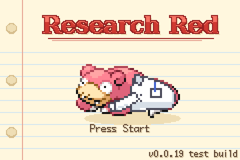
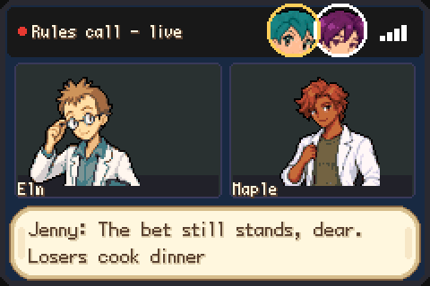
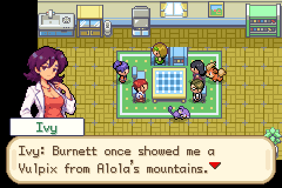
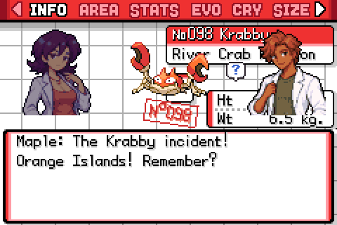
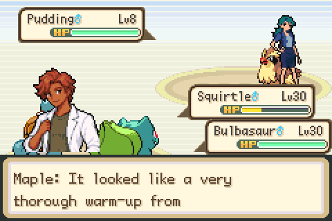
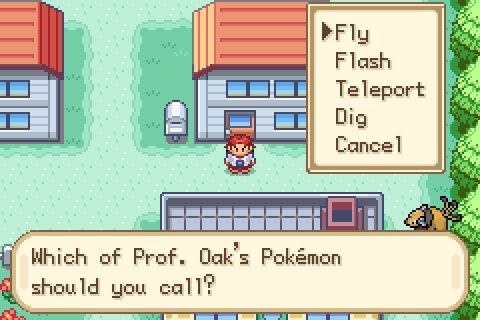
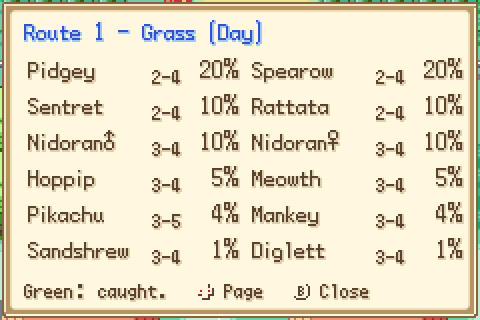

# Pokémon Research Red

A cozy, funny FireRed hack for grown-ups who grew up with Pokémon.

  

## The story (no spoilers)
You and Ivy, two Pokémon professors, set out across Kanto with Elm and Jenny. There's
one big research paper to write, and a friendly race to eight badges. Take your time:
catch what you love, take notes, and enjoy the road.

Research Red is told from the point of view of an adult and a scientist. It plays like
a sitcom: a cozy, lived-in world, friends who are family, healthy and sweet romances,
running jokes, and a lot of laughing at the absurdity of it all. Sometimes it's silly
and slapstick, and sometimes it's a chance to talk science: Pokémon lore science and
real science. You don't need to be a scientist to enjoy it, but if you are, we hope
it feels a bit like home.

Nothing in it is too grown-up for Pokémon. It's simply written for the people who played
Red, Blue, Gold and Silver as kids and still love them.

> **Status: early test builds.** Pallet Town to Pewter City is playable, up to and
> including Brock. Saves may not carry over between test builds before v0.1.

## A love letter
This is a love letter to the Gen 1 and Gen 2 games and anime, and to the parts of the
last 30 years of Pokémon that brightened our lives. It takes the scientists and
researchers of the games and the show, people like Prof. Elm, who never got much of
the spotlight, and Prof. Oak, Delia and Daisy, and folds them into a different take on
the gym run, without taking anything away from the games we grew up with.
Along the way it explores what Mega Evolution, regional forms and new evolutions mean
for the Gen 1 and Gen 2 starters.

The idea started with a Slowpoke sticker on a desk in a lab.

## Screenshots
| | |
|---|---|
|  |  |
| Video calls with the cast | Story scenes with character portraits |
|  |  |
| Every Pokémon you register gets a little scene | Your team talks back in battle |
|  |  |
| The Ranch Pager: no HM slaves | The Field Guide: what lives here, day and night |

## What makes it different
- **You have a voice.** The player is a character with their own jokes and opinions,
  and every scene has dialogue portraits, so you always see who's talking.
- **You're the professor.** You travel with Ivy as your partner (she follows you
  and chats about wherever you are), with Elm and Jenny as friendly rivals: former
  students, mentors, colleagues and friends who are family (Pokémon included).
- **Double battles by default.** You and Ivy battle side by side, against pairs like
  Elm and Jenny.
- **Pokédex banter.** Register a Pokémon and its entry plays a little scene: Ivy
  and you trade notes, the Pokémon hops, its number gets stamped in, and sometimes
  Elm or Jenny calls in. Every Gen 1 and Gen 2 Pokémon has its own lines.
- **Play it your way.** Research Rules (in Options): level caps on or off, double or
  single battles, battle style, heal after every battle. Easy to pick up after work,
  as relaxed or as challenging as you like. Change a rule and Elm and Jenny call to
  talk it over.
- **Ranch Pager.** Call Prof. Oak's Pokémon to Fly, Flash, Teleport or Dig. They
  also Cut, Surf and push boulders when nobody on your team knows the move.
- **It's a grant-funded project.** The research grant pays for your supplies: Lab
  Supplies is a free shop on every PC with Poké Balls, medicine, held items and
  vitamins, and the grant covers every TM (100 of them, never used up) and every key
  item. The Field Guide tells you what lives where, by day and by night.
- **Evolve when you want.** An Evolve option in the party menu; trade evolutions
  without trading; relearn earlier forms' moves at any level; rename anytime.
- **Held items and Berries come back** after every battle.
- **Rematches** that grow with your badges: Prof. Oak and Daisy, Delia, and Brock
  at a difficulty you choose.
- **A living world.** Anime-inspired wild Pokémon with Johto neighbours, different
  by day and by night; Pokémon out and about in towns; rest at a Pokémon Center to
  skip to night or morning; the PC, DexNav and Field Guide from the Start menu.

## How to play
1. Get the **Pokémon FireRed (USA) v1.1 (Rev 1)** ROM from your own cartridge.
   SHA1 `dd5945db9b930750cb39d00c84da8571feebf417`.
2. Download the `.bps` patch from [Releases](../../releases).
3. Apply it with [Rom Patcher JS](https://www.marcrobledo.com/RomPatcher.js/) or Floating IPS.
4. Play in [mGBA](https://mgba.io/) (recommended).

This repository only ever contains patches and source code: **no ROMs**, and please
don't ask for or share them in Issues.

Full history: [docs/CHANGELOG.md](docs/CHANGELOG.md). Player guides (wild Pokémon,
trainers, items): [docs/player/](docs/player/).

## A first project
This is our first real attempt at scripting, story and dialogue writing, software
planning and making a game. It will make mistakes, and we'll try our best to learn
from them, stay kind and professional, and share what we learn along the way: the
systems, tools and ideas that come out of it.

## Feedback
Bug reports and ideas are welcome on the [Issues](../../issues) tab (there are forms
for each). This is a hobby project, so replies may be slow. Thank you for being kind.

## Credits
- Built on [pokefirered-expansion](https://github.com/rh-hideout/pokefirered-expansion)
  (rh-hideout) and [pret's pokefirered](https://github.com/pret/pokefirered) disassembly.
  Their original README: [docs/ENGINE_README.md](docs/ENGINE_README.md).
- Story, characters and creative direction: MudrockNGS.
- Made with help from Claude, an AI assistant, for the programming, tools, testing and
  draft text. The story, characters and creative direction are MudrockNGS's.
- Everything else, asset by asset: [CREDITS.md](CREDITS.md).

## Thank you
To Nintendo, Creatures and Game Freak for the games and the show that made all of
this worth daydreaming about, and to the Pokémon ROM hacking community, whose years of
hard work (the disassemblies, the expansion and the tools) made even the craziest of
these ideas possible.

## Disclaimer
Research Red is a free, non-commercial fan project. It is not affiliated with, endorsed
by, or sponsored by Nintendo, Creatures Inc., Game Freak or The Pokémon Company.
Pokémon and all related names are trademarks of their respective owners. No money is
made from it, and there are no donations, paid builds or paid perks.
